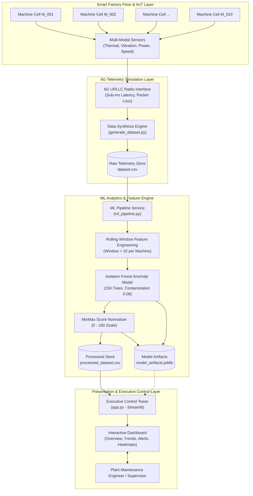
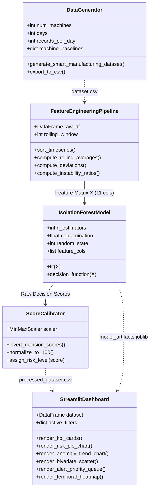
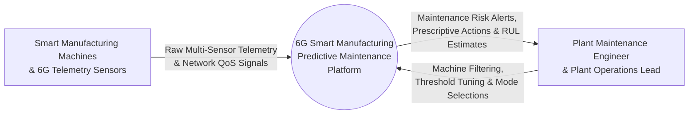
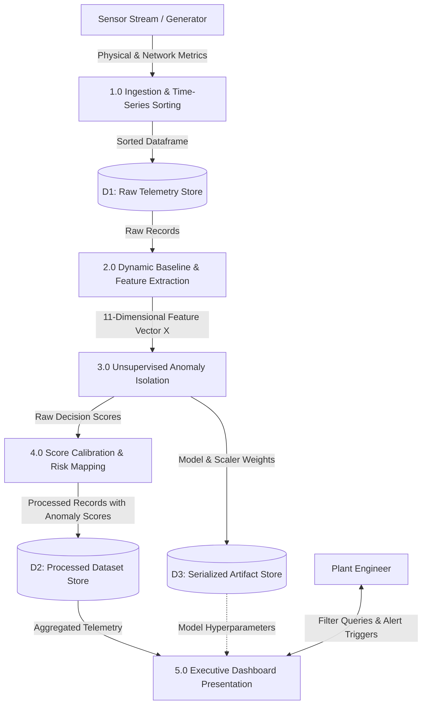
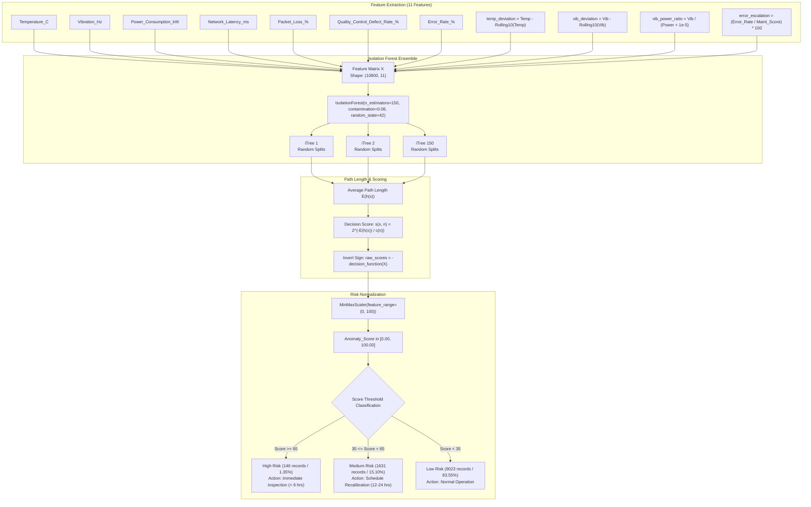
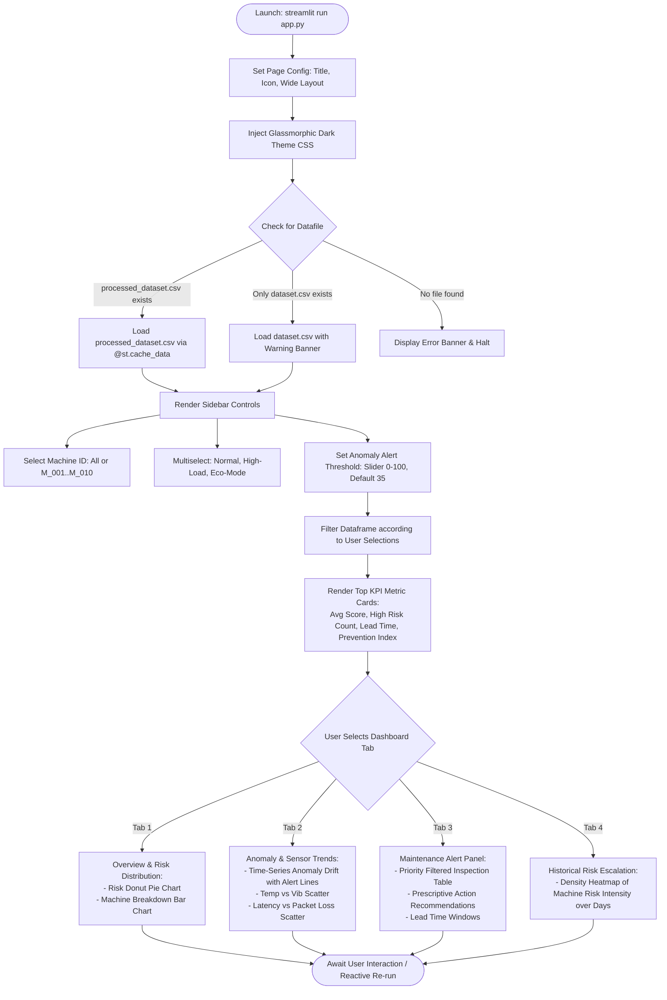
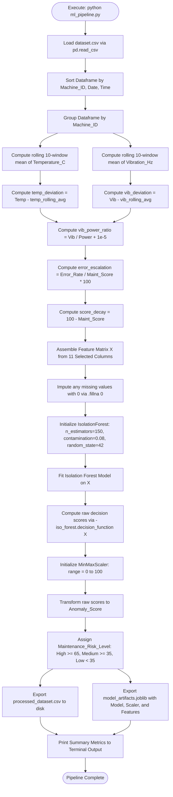
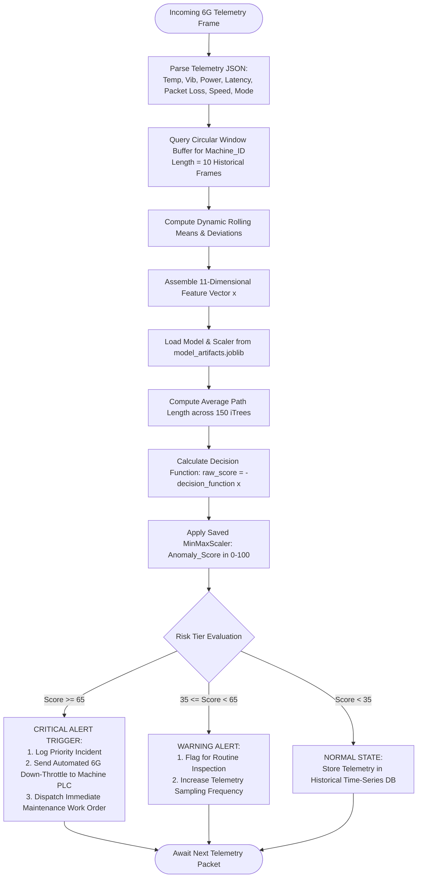

<!-- markdownlint-disable MD033 MD013 MD025 MD024 -->
# ARCHITECTURE AND TECHNICAL DIAGRAMS SPECIFICATION
## PREDICTIVE MAINTENANCE FOR 6G-ENABLED SMART MANUFACTURING

This document provides formal architectural models, flowcharts, and Data Flow Diagrams (DFDs) representing the end-to-end design of the predictive maintenance platform. Every diagram is accompanied by an architectural breakdown mapped directly to source files and line numbers.

---

## 1. HIGH-LEVEL SYSTEM ARCHITECTURE

### Technical Explanation: High-Level Architecture
- **Factory Floor Layer:** Simulates 10 industrial machines (`M_001` to `M_010`) operating across `Normal`, `High-Load`, and `Eco-Mode` regimes (`generate_dataset.py`, lines 11–12).
- **6G Telemetry Layer:** Combines physical sensors with 6G network indicators (Gamma-distributed latency and Normal-distributed packet loss) saved to `dataset.csv` (`generate_dataset.py`, lines 63–66).
- **Analytics Engine:** Ingests `dataset.csv`, computes grouped rolling moving averages and physical ratios, fits 150 isolation trees, normalizes scores from 0 to 100, and saves `processed_dataset.csv` and `model_artifacts.joblib` (`ml_pipeline.py`, lines 7–55).
- **Presentation Layer:** Reactive web UI in `app.py` delivering real-time filtering, risk aggregation, and prescriptive inspection scheduling.

---

## 2. COMPONENT ARCHITECTURE DIAGRAM

### Technical Explanation: Component Architecture
- **DataGenerator (`generate_dataset.py`):** Configures machine baseline dictionaries with initial operating temperatures, vibration, power, wear inception days, and degradation velocities.
- **FeatureEngineeringPipeline (`ml_pipeline.py`):** Executes time-series sorting and windowed group transformations using Pandas `.transform(lambda x: x.rolling(10, min_periods=1).mean())`.
- **IsolationForestModel (`ml_pipeline.py`):** Encapsulates Scikit-learn's `IsolationForest` parameterized with 150 estimators and 8% contamination.
- **ScoreCalibrator (`ml_pipeline.py`):** Inverts the negative decision function and maps scores into $[0.0, 100.0]$, classifying them into discrete `High`, `Medium`, and `Low` risk buckets.
- **StreamlitDashboard (`app.py`):** Ingests processed data, provides reactive caching via `@st.cache_data`, and generates Plotly graphical objects.

---

## 3. DATA FLOW DIAGRAMS (DFD)

### 3.1 DFD Level 0 (Context Diagram)

### 3.2 DFD Level 1 (Functional Decomposition)

---

## 4. MACHINE LEARNING PIPELINE DIAGRAM

---

## 5. APPLICATION EXECUTION FLOWCHART (`app.py`)

---

## 6. MODEL TRAINING FLOWCHART (`ml_pipeline.py`)

---

## 7. MODEL INFERENCE FLOWCHART (REAL-TIME STREAMING EXTENSION)

